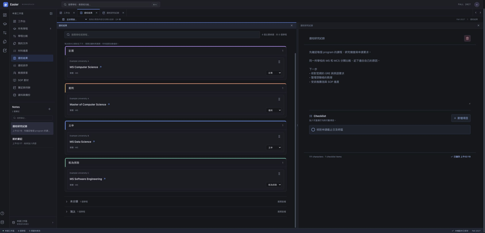

<p align="center"></p>

# Easier

**把研究所申請整理成自己的工作區。**

Easier 是免費、開源的學程研究與申請管理工具：整理選校結果、比較不同 program、記錄想法、追蹤材料與文件。採用繁體中文介面，內建像編輯器一樣的並排工作區；導覽集中於單一側欄，拖曳時僅顯示游標所在的淡色落點預覽。

**Free, open-source graduate application workspace.** Organize programs, shortlist decisions, notes, documents and application materials. Traditional Chinese interface. Works locally without an account; optional Supabase sync uses your own project.

[下載原始碼 ZIP](https://github.com/Russell512/Easier-Open/archive/refs/heads/main.zip) · [回報問題](https://github.com/Russell512/Easier-Open/issues) · [MIT 授權](LICENSE)



## 可以做什麼？

- **以學程為單位研究**：同一所學校的 MSCS、MCS 或其他學位分開管理；查看要求、時程、研究線索與官方連結。
- **從網頁新增學程**：按「新增學程」，填學校與學程名稱就能開始。也可下載 CSV 範本／目前清單及 AI 提示詞，再上傳或貼上 CSV 檢查；預覽會列出錯誤與重複資料。每次最多 500 列、5 MB，只加入新學程，原有進度和筆記保留。新增資料標為待核實，附全新的材料清單，之後可在學程頁「編輯學程資料」補填。
- **清楚的選校結果**：彩票、衝刺、主申、較為保險分成四個向下排列的區域，卡片依可用寬度排列。頁面上方的「匯出選校 CSV」只包含這四類中的全部學程，不受搜尋影響；分類置前，保留目前修改的學程資料。未分類與淘汰預設收合，展開後仍可搜尋、重新分類。
- **最多四欄並排**：拖曳頂部分頁或筆記到內容的左／右側，或用「並排開啟」選單。每欄獨立捲動；三點分隔線可拖曳調寬，雙擊平分，方向鍵微調。右上角 × 關閉後，其他欄位按比例填補空間。
- **Notes 側欄**：像筆記 App 一樣集中查看、搜尋、新增筆記。點選在右側開啟；可同時編輯不同筆記，每篇包含文字與 checklist。學程專屬筆記也會出現在清單。
- **Markdown 編輯器**：工具列支援粗體、螢光標記、超連結及清單，提供編輯／並排／預覽與一鍵複製完整 Markdown，包含標題和 checklist。
- **材料與文件**：追蹤 CV、SOP、成績單、考試、推薦信；保留文件版本及適用學程。加入文件不代表已提交申請。
- **Excel 與備份**：匯入／匯出 `.xlsx`、匯出學程 `.csv`，完整備份包含筆記與文件。
- **帳號選單與頭像**：點右上角頭像開啟設定，上傳照片或使用 Google 頭像。同步、完整備份、匯入、雲端 Excel、修改密碼與登出集中於此；同步狀態顯示在底部。
- **每個帳號各自的工作區**：雲端使用者可透過 Google 登入，新帳號從空白學程清單開始。既有 Email 帳號也可登入；Email 註冊須由站方配置寄信服務後啟用。學程、筆記、文件、版本歷史與分享設定彼此隔離，不需要站方手動配發 Excel。
- **選用雲端同步**：使用自己的 Supabase，登入後同步變更，版本衝突時保留兩邊資料供選擇。

## 5 分鐘開始

需要 **Node.js 22+** 與 npm。下載 ZIP 後解壓縮，或：

```bash
git clone https://github.com/Russell512/Easier-Open.git
cd Easier-Open
npm ci
npm run dev
```

打開終端顯示的網址（通常 `http://localhost:5173`）。開發模式未設定 Supabase 時會使用本機範例，**不用登入或設定帳號**。若已有雲端設定，仍可用 `VITE_LOCAL_MODE=true npm run dev` 明確切回本機模式。正式部署請選擇 `build:local`，或完成雲端設定後使用 `build:cloud`；正式雲端版不會因缺少設定而改讀公開 Excel。

1. 從「選校結果」試著拖拉示範卡片，或使用卡片上的選單。
2. 按側欄 Notes 的 `+`，在右側記錄想法。
3. 用「並排開啟」加一個學程，拖動分隔線，試試 2–4 欄。
4. 在「所有學程 → 新增學程」手動填寫，或使用 CSV 範本與 AI 提示詞批次整理。

本 repo 附 **6 個虛構學程**，不是經過查證的招生清單。截止日、考試要求與費用刻意不填猜測值。請填入各學程官方來源與查核日期。沒有任何人的選校評分、私人筆記、履歷或帳號金鑰。

## 自訂 Excel

起始檔位於 [`public/data/update_info.xlsx`](public/data/update_info.xlsx)。可先從應用程式匯出，保留工作表名稱與欄名，再替換資料列。

| 工作表 | 用途與關聯 |
| --- | --- |
| `Programs` | 每列一個學程；`University` + `Program Name` 作為身分 |
| `Application Checklist` | 每學程一列；`University` + `Program` 必須對上學程名称 |
| `Per-Program Timeline` | 每學程的任務、官方日期與個人目標日 |
| `Faculty` | 教授研究線索，可保持空白 |
| `Master Timeline` | 跨學程的整體計畫 |
| `Easier Template` | 範本識別，請保留 |

同校不同學程必須用不同名稱。更名可能影響與舊筆記、分類、文件的關聯，匯入前先下載「完整搬移備份」。重新產生原始示範檔可執行 `node scripts/create-demo-workbook.mjs public/data/update_info.xlsx`；這會覆寫該檔案。

## 儲存方式

| 模式 | 資料放哪裡 | 是否跨裝置同步 |
| --- | --- | --- |
| 本機／靜態網站 | 該網址及瀏覽器的 localStorage、IndexedDB | 不會；請匯出／匯入完整備份 |
| 自建 Supabase | 自己的資料庫與私人檔案 bucket，加上瀏覽器副本 | 會；修改後自動上傳 |

頭像與顯示名稱是帳號設定，不包含在工作區備份或分享內容中。雲端模式將頭像放在私人 `easier-avatars` bucket，設定保存在 Supabase 帳號；本機模式只保存在該瀏覽器。現有部署需執行 `202610150001_account_avatars.sql` 才能上傳頭像。

本機模式清除網站資料、換瀏覽器或換網址不會自動帶走資料。請定期點右上角頭像 →「完整備份」。分頁布局是各裝置自己的偏好；筆記內容則會跟著工作區同步。不是電腦資料夾背景同步，也不會把每次修改推到 GitHub。

雲端模式會按帳號保留各自的本機副本，包括尚未同步的修改與文件。切換帳號先封存原帳號，再載入目前帳號自己的內容；重新登入原帳號可恢復其副本。舊版資料若無法確認帳號歸屬，會隔離保留並提示，不會自動匯入下一個登入者的工作區。這些瀏覽器副本不是雲端權限的替代；在共用裝置上，請登出並視需要清除網站資料，清除前先備份尚未同步的內容。

## 建置與部署

### 免帳號的靜態版本

```bash
npm run build:local
npm run preview
```

輸出在 `dist/`，可交給一般靜態網站主機。repo 的 Vercel 設定預設使用 `build:local`，GitHub 匯入後即可部署。每位訪客的資料只存在自己的瀏覽器。

**靜態模式的 `public/` 是公開資源。只放示範／可公開的 Excel；個人資料請在網頁中匯入。** 沒有 service worker，首次載入與重新整理仍需要伺服器可連線。

### 使用自己的 Supabase（選用）

1. 建立 Supabase 專案，按檔名順序執行 `supabase/migrations/` 的 SQL，建立工作區、版本歷史、私人 storage bucket 與 RLS。
2. 包含 `202610190001_self_service_workspaces.sql`：已驗證且非匿名的帳號首次登入時，會透過 `easier_ensure_workspace_access` 取得自己的工作區。無須手動插入 owner row；RLS、私人檔案路徑與分享資料仍限制為本人。
3. 設定 Google provider 與正式 Site URL／Redirect URLs，即可讓新使用者登入自己的空白工作區。Email 註冊預設關閉；要開放時，先配置並實測自訂 SMTP 與確認信，再於部署環境設定 `VITE_EMAIL_SIGNUP_ENABLED=true` 並重新建置。使用者須依提示完成確認，未取得 session 前不開啟工作區。新帳號不需要 seed；已有 `<使用者 UUID>/seed/update_info.xlsx` 的帳號沿用自己的 seed，不會複製給其他人。
4. 複製 `.env.example` 為 `.env.local`，填入你自己的 Supabase URL 與 **publishable / anon client key**。把 `VITE_LOCAL_MODE` 設為 `false`。**不要使用 `service_role` 金鑰**。
5. 部署環境也設定相同變數，將 Vercel 的 Build Command 改為 `npm run build:cloud`。`build:cloud` 會移除 `dist/data`；雲端不會回退讀取公開 Excel。私人 seed 僅在明確不存在（404）時改用空白範本，權限與網路錯誤會保留為錯誤。
6. 先用測試帳號確認登入、編輯、重新登入与完整備份，再搬入自己的資料。

不要把 `.env.local`、資料庫備份或私人 Excel 提交進公開 repo。同步會檢查 revision；遇到兩台裝置同時修改，先备份再選擇版本。一次只允許同一瀏覽器一個分頁編輯雲端工作區，應用程式內的四欄不受此限制。

### 登入與唯讀分享

登入頁含 Easier 標誌、Google／Apple 圖示及既有 Email 帳號登入。原站目前開放 Google 新帳號，Email 註冊因尚未配置自訂 SMTP 而維持關閉。Apple 需要具備 Apple Developer Program 權限的團隊、Services ID 與簽名憑證；一般 Apple Developer 註冊不足以啟用網頁登入。原站目前維持 Apple 停用，按鈕會說明狀態。自行部署的設定請見 [Apple 登入設定](docs/apple-sign-in.md)，完成後先測試再啟用。

依 [Supabase Google 登入文件](https://supabase.com/docs/guides/auth/social-login/auth-google)，在 Google Auth Platform 建立 Web OAuth 用戶端，將 Supabase 的 `/auth/v1/callback` 加到 Authorized redirect URIs，再把 Client ID / Secret 填入 Supabase 的 Google provider。Secret 只放在 Supabase，不可放進 `VITE_*`。在 Supabase URL Configuration 設定網站網址與允許的回跳網址。工作區依 Supabase 驗證後的使用者 UUID 歸屬，不依顯示名稱合併；若用不同登入方式進入不同帳號，各自擁有獨立資料。

Google 品牌設定需填寫實際網站首頁與隱私權說明。部署前請按你的服務設定修改 `public/privacy.html` 與聯絡方式，並在 Google Auth Platform 將目標對象設為正式發布。只需基本 `openid`、Email 與個人資料範圍，無須 Gmail 或 Drive 權限。Supabase Redirect URLs 可使用你的正式網站 `https://你的網域/**`，讓登入後保留分享連結；不要允許不受你控制的網域。

在「選校結果 → 分享」開啟連結，可選持有連結即可查看，或必須登入。分享預設關閉，僅包含彩票、衝刺、主申、較為保險及學程公開資訊。私人筆記、文件、個人評分和準備進度不會放入分享資料。雲端同步時會更新分享內容；可停止分享或更換連結。分享頁每 20 秒及回到頁面時重新檢查；停止分享後，已開啟的頁面會在下一次檢查隱藏內容。

分享使用獨立的唯讀頁面與資料庫 RPC；匿名使用者不能列出分享 token，也無法取得完整工作區或寫入資料。純本機模式不提供連結分享。

## 開發與檢查

```bash
npm run lint
npm run typecheck
npm run test:tabs
npm run test:shortlist
npm run test:sharing
npm run test:notes
npm run test:program-import
npm run test:auth
npm run test:starter
npm run test:accounts
npm run test:account-user
npm run test:documents
npm run test:autosync
npm run test:demo
npm run build:local
```

React 19 · TypeScript · Vite · SheetJS · dnd-kit · Supabase · Lucide

- `src/components/workbench/`：工作區、選校與學程頁
- `src/lib/workspaceTabs.ts`：分頁、分欄、比例與還原規則
- `src/lib/notes.ts`、`src/hooks/useApplicationNotes.ts`：筆記與自動儲存
- `src/lib/cloudSnapshot.ts`：雲端資料、Excel 與完整備份
- `supabase/migrations/`：可自行部署的資料庫結構

歡迎用 Issues 提出問題或提交 Pull Request。回報請附重現步驟與瀏覽器版本，使用虛構資料重現，避免貼出自己的申請文件或金鑰。

## 授權

程式碼與虛構範例採 [MIT License](LICENSE)，可免費下載、修改與分享。第三方套件依各自授權；PDF 匯出的 Noto Sans TC 字型採 [SIL Open Font License 1.1](public/assets/OFL-NotoSansTC.txt)。
